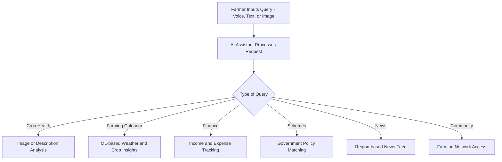

# 🌾 Millets – AI-Powered Farmer Support Platform

Millets is an AI-powered, multilingual platform designed to transform the agricultural landscape by empowering farmers with intelligent tools, personalized insights, and a collaborative community. Built with a strong emphasis on accessibility, sustainability, and real-world problem-solving, Millets leverages AI/ML technologies to assist farmers in making informed decisions.

---

## 🚀 Overview

Agriculture remains the backbone of many economies, yet farmers often lack access to expert advice, up-to-date information, and inclusive technologies. **Millets** bridges this gap with an intelligent assistant and robust ecosystem tailored to rural needs, language diversity, and real-time agricultural support.

---

## 🧠 Key Features

- **🗣️ AI Voice Assistant with Multi-Lingual Support**  
  Natural voice interaction in local languages for intuitive accessibility.

- **📅 ML-Powered Farming Calendar**  
  Smart scheduling and crop cycle insights based on regional data and weather forecasts.

- **💰 Farming Finance Tracker**  
  Monitor expenses, track income, and get profit reports with real-time notifications.

- **🏛️ Government Schemes & Insurance Hub**  
  Personalized recommendations for relevant schemes, subsidies, and crop insurance.

- **📰 Region-Based Smart News Feed**  
  Daily updates on agri-market trends, innovations, and weather predictions.

- **🔧 Shared Machinery Module**  
  Connect with nearby farmers to share tools and equipment efficiently.

- **👥 Collaborative Farming Community**  
  A social platform to interact, share experiences, and get help from fellow farmers and agri-experts.

---

## 🌱 Real-World Impact

Millets empowers farmers to:
- Improve crop yield and health with AI diagnostics.
- Adopt sustainable practices with personalized suggestions.
- Collaborate and grow through community-driven farming.
- Increase profitability via smarter financial and resource planning.

---

## 🛠️ Tech Stack

## 🛠️ Tech Stack

| Category        | Technologies Used                                                                 |
|----------------|-------------------------------------------------------------------------------------|
| **Frontend**    | React Native / Flutter                                                             |
| **Backend**     | Node.js with Express.js                                                            |
| **Database**    | MongoDB / Firebase                                                                 |
| **AI/ML**       | Python (TensorFlow, OpenCV), NLP APIs                                              |
| **Cloud**       | AWS / Google Cloud Platform                                                        |
| **Other Tools** | Dialogflow, Twilio (Voice/Chat), Agriculture APIs                                  |

---

## 📈 System Workflow

🔍 Future Enhancements
Offline mode support for low-connectivity regions

Integration with IoT sensors for smart soil/moisture tracking

Voice biometrics for enhanced security

AI-driven crop yield prediction

📌 Why Millets?
This project demonstrates:

✅ Practical use of AI in agriculture

✅ Cross-domain integration (ML, NLP, databases, finance, community features)

✅ Real-world problem-solving mindset

✅ Scalable product thinking with inclusive design

👨‍💻 Developed By
*Team Vanquish*

